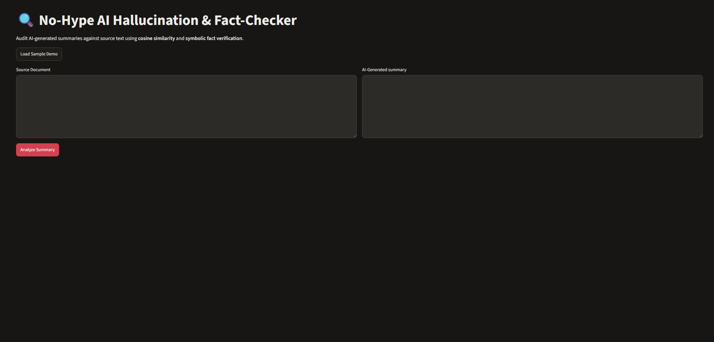

# 🔍 No-Hype AI Hallucination & Fact-Checker

**[🚀 Launch Live Interactive App](https://ai-fact-checker-project2.streamlit.app/)**

A lightweight verification engine that audits AI-generated summaries against original source documents by combining **dense vector cosine similarity** with **symbolic hard-fact verification**.



---

## 🎯 The Problem
Standard semantic similarity models (like sentence embeddings) excel at measuring *topical* overlap, but often fail to catch subtle factual hallucinations. For example:
> *"Mining began in 1893 and produced 1.8 million tonnes."* vs. *"Mining began in 1995 and produced 50 million tonnes."*

Because both sentences share the exact same grammatical structure and vocabulary, pure cosine similarity scores them above `0.85`—completely missing the fabricated numbers.

## 🧮 Mathematical & Algorithmic Architecture

This tool solves that blind spot with a two-stage hybrid pipeline (`math_engine.py`):

1. **Sentence Discretization (`NLTK`):** Tokenizes raw source and summary paragraphs into individual claims ($S = [s_1, \dots, s_n]$ and $A = [a_1, \dots, a_m]$) while preserving decimal numbers and abbreviations.
2. **Pairwise Cosine Similarity Matrix:** Maps each sentence to an $L_2$-normalized vector in $\mathbb{R}^{384}$ using `all-MiniLM-L6-v2` ($\|\mathbf{v}\|_2 = 1$). Because all embeddings are unit vectors, pairwise cosine similarity reduces to a single matrix dot product:
   $$\mathbf{C} = \mathbf{M}_A \mathbf{M}_S^\top \in \mathbb{R}^{m \times n}$$
   For each summary sentence $a_i$, the engine extracts its maximum alignment score $\text{sim}(a_i) = \max_j C_{i,j}$ and best-matching evidence sentence $j^* = \arg\max_j C_{i,j}$.
3. **Set-Theoretic Fact Audit:** Extracts numerical tokens (integers, decimals, currencies, percentages) and mid-sentence proper nouns via regular expressions. If a summary sentence introduces tokens not found anywhere in the source text ($U_i = N_{a_i} \setminus N_S \neq \emptyset$), a configurable multiplicative penalty ($\alpha \in [0, 1]$) is applied.
4. **Length-Weighted Trust Score:** Aggregates sentence scores weighted by word count ($w_i$) so brief filler sentences do not skew document-level reliability:
   $$\text{Trust Score} = \left(\frac{\sum_{i=1}^{m} w_i \cdot \text{score}(a_i)}{\sum_{i=1}^{m} w_i}\right) \times 100$$

---

## 🛠️ Tech Stack
* **Language:** Python 3.11+
* **NLP & Embeddings:** `sentence-transformers` (`all-MiniLM-L6-v2`), `nltk` (Punkt tokenizer)
* **Linear Algebra & Math:** `numpy`, `re`
* **Frontend & Deployment:** `streamlit`

---

## 🚀 Run Locally

```bash
# 1. Clone the repository
git clone https://github.com
cd ai-fact-checker

# 2. Install dependencies
pip install -r requirements.txt

# 3. Launch the Streamlit app
streamlit run app.py
```

---

## ⚠️ Known Limitations & Future Improvements (v2)
* **Logical Negations:** Dense cosine similarity struggles with direct contradictions (e.g., *"The treatment succeeded"* vs. *"The treatment failed"* share high vector proximity). Future versions will integrate a **Natural Language Inference (NLI) cross-encoder** (`roberta-large-mnli`) to explicitly classify entailment vs. contradiction.
* **Synonym & Unit Equivalence:** Exact regex set-matching currently flags equivalent expressions like `"1,800,000"` vs. `"1.8 million"` as unverified tokens; normalizing numeric magnitudes is planned for v2.